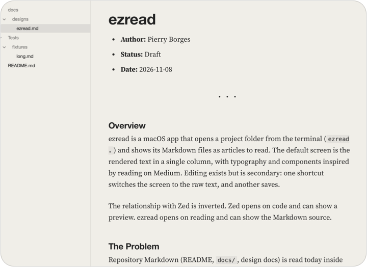
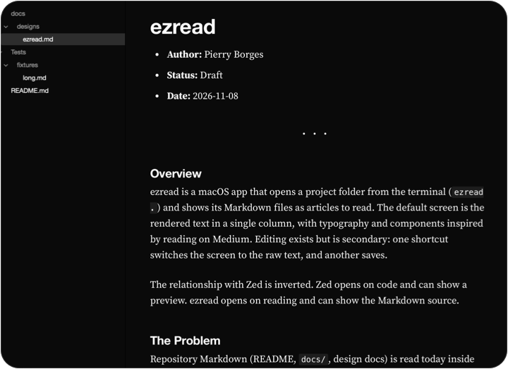
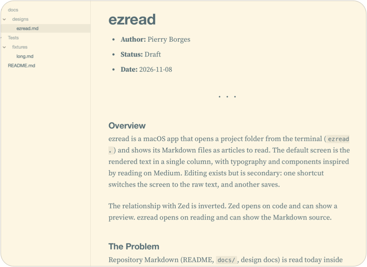
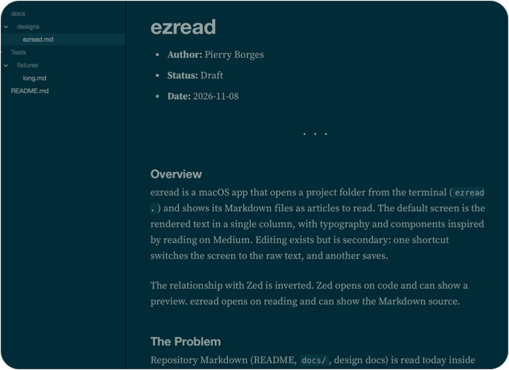
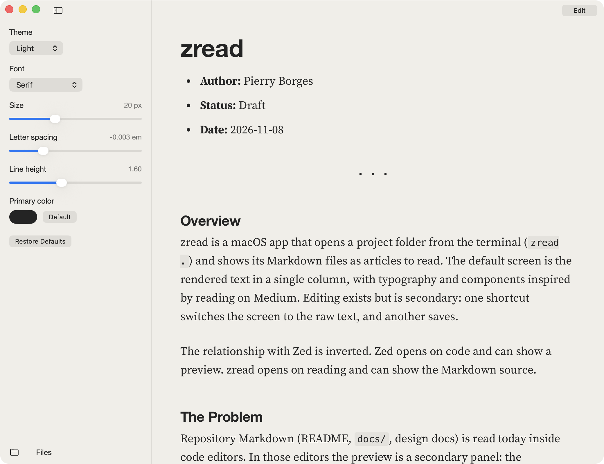

# ezread

Read the Markdown in your repo like it's an article.

[](https://github.com/Pierry/ezread/releases)


[](https://github.com/Pierry/homebrew-ezread)
[](LICENSE)

[Website](https://pierry.github.io/ezread/)

<p>
  
  
  
  
</p>

## What it is

ezread is a small Mac app for reading Markdown. Type `ezread .` in any folder and
its docs open as clean, comfortable pages. The whole app is about 1 MB.

## The problem

Most of us read READMEs and design docs inside a code editor. The preview there
is a side panel, the type wasn't chosen for long text, and tabs and toolbars sit
all around it. Reading a good doc shouldn't feel like debugging.

ezread opens on the text itself. Nothing else competes for your attention.

## Light on purpose

ezread opens as fast as Zed, uses about half of its memory, and takes up 1 MB on
disk.

| App | Window on screen | Memory | Size on disk |
| --- | --- | --- | --- |
| **ezread 0.1.2** | **395 ms** | **203 MB** | **1 MB** |
| Zed 1.27.0 | 398 ms | 396 MB | 176 MB |
| Ghostty 1.3.1 | 513 ms | 594 MB | 62 MB |

Measured on one M4 Pro with macOS 26.3.1. Each number is the median of five warm
launches, with ezread and Zed opening a 400-section document and Ghostty opening
an empty window with its existing config. Memory is physical footprint six
seconds after launch, and includes the WebKit helpers ezread relies on. These apps
do different jobs: Zed is a full editor, Ghostty is a terminal, and ezread stays
small because WebKit already ships with macOS.

## Install

```sh
brew install pierry/ezread/ezread
```

That's it. You need macOS 14 or later and Xcode, because Homebrew builds the app
on your Mac. ezread isn't notarized by Apple yet, and building it locally means
macOS opens it without a warning.

## Coming from zread

ezread was called zread until 0.3.0. Your reading settings carry over on the
first launch. To switch the Homebrew install:

```sh
brew uninstall zread && brew untap pierry/zread
brew install pierry/ezread/ezread
```

## Update

```sh
brew update && brew upgrade pierry/ezread/ezread
```

**This command is the only way to get a new version.** ezread runs entirely
offline: it never connects to the internet, so it can't check for updates or
tell you that one exists. Run the command whenever you want the latest release,
then reopen the app.

The one exception is the What matters? button. Only when you click it, ezread
runs your own Claude Code, which sends the open document to Anthropic under your
account. Without Claude Code, everything else works the same.

## Use it

```sh
ezread .
ezread docs/design.md
```

ezread picks up where you left off: same file, same spot, same window. Links
between your docs open right in the app, and the sidebar lists every Markdown
file in the project. If a file changes on disk, ezread reloads it when you come
back to the window.

Spotted a typo? Click Edit at the top right, fix it, click Save, then click Read
to go back to the page.

## Make it yours

Open Settings at the bottom of the sidebar to choose the theme, font, bold,
size, letter spacing and line height. Changes show up as you make them, and
ezread remembers them. Each document can also get its own color for headings
and links; it starts black and is saved with the file.



| Shortcut | What it does |
| --- | --- |
| `Cmd+E` | Switch between reading and editing |
| `Cmd+S` | Save |
| `Cmd+1` | Show or hide the sidebar |
| `Cmd+,` | Open settings |
| `Cmd+O` | Open a folder or file |

## Safe to point at any repo

ezread never runs anything from a Markdown file. It drops raw HTML, skips remote
images, and only reads images inside the folder you opened. The tradeoff is that
remote badges in a README won't show up, including the ones on this page.

## Build it yourself

```sh
swift test
scripts/bundle.sh
open build/ezread.app
```

Curious about the decisions behind it? The design doc is in
[docs/designs/ezread.md](docs/designs/ezread.md).

## License

MIT. ezread also ships [cmark-gfm](https://github.com/swiftlang/swift-cmark),
[highlight.js](https://highlightjs.org/) and
[Source Serif Pro](https://github.com/adobe-fonts/source-serif). Their licenses
are in `Resources/vendor/`.
