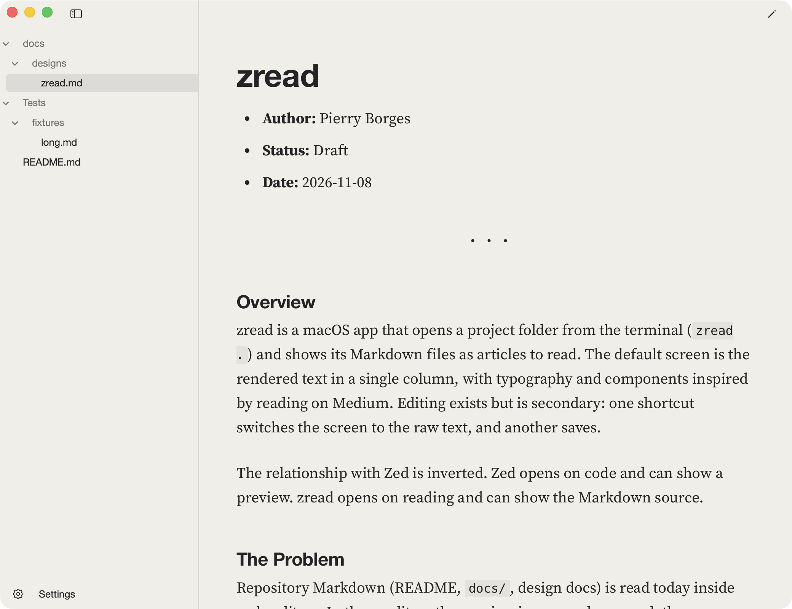

<p align="center">
  
</p>

<h1 align="center">zread</h1>

<p align="center">Read the Markdown in your repo like it's an article.</p>

<p align="center">
  <a href="https://github.com/Pierry/zread/releases"></a>
  
  
  <a href="https://github.com/Pierry/homebrew-zread"></a>
  <a href="LICENSE"></a>
</p>

<p align="center"><a href="https://pierry.github.io/zread/">Website</a></p>

<picture>
  <source media="(prefers-color-scheme: dark)" srcset="docs/assets/dark.png">
  
</picture>

## What it is

zread is a small Mac app for reading Markdown. Type `zread .` in any folder and
its docs open as clean, comfortable pages. The whole app is about 1 MB.

## The problem

Most of us read READMEs and design docs inside a code editor. The preview there
is a side panel, the type wasn't chosen for long text, and tabs and toolbars sit
all around it. Reading a good doc shouldn't feel like debugging.

zread opens on the text itself. Nothing else competes for your attention.

## Install

```sh
brew install pierry/zread/zread
```

That's it. You need macOS 14 or later and Xcode, because Homebrew builds the app
on your Mac. zread isn't notarized by Apple yet, and building it locally means
macOS opens it without a warning.

## Use it

```sh
zread .
zread docs/design.md
```

Links between your docs open right in the app, and the sidebar lists every
Markdown file in the project. If a file changes on disk, zread picks it up when
you come back to the window.

Spotted a typo? Click the pencil at the top right, fix it, save, and click the
book to go back to reading.

## Make it yours

Open Settings at the bottom of the sidebar to choose the theme, font, size,
letter spacing, line height and the color of your headings and links. Changes
show up as you make them.


| Shortcut | What it does |
| --- | --- |
| `Cmd+E` | Switch between reading and editing |
| `Cmd+S` | Save |
| `Cmd+\` | Show or hide the sidebar |
| `Cmd+,` | Open settings |
| `Cmd+O` | Open a folder or file |

## Safe to point at any repo

zread never runs anything from a Markdown file. It drops raw HTML, skips remote
images, and only reads images inside the folder you opened. The tradeoff is that
remote badges in a README won't show up.

## Build it yourself

```sh
swift test
scripts/bundle.sh
open build/zread.app
```

Curious about the decisions behind it? The design doc is in
[docs/designs/zread.md](docs/designs/zread.md).

## License

MIT. zread also ships [cmark-gfm](https://github.com/swiftlang/swift-cmark),
[highlight.js](https://highlightjs.org/) and
[Source Serif Pro](https://github.com/adobe-fonts/source-serif). Their licenses
are in `Resources/vendor/`.
